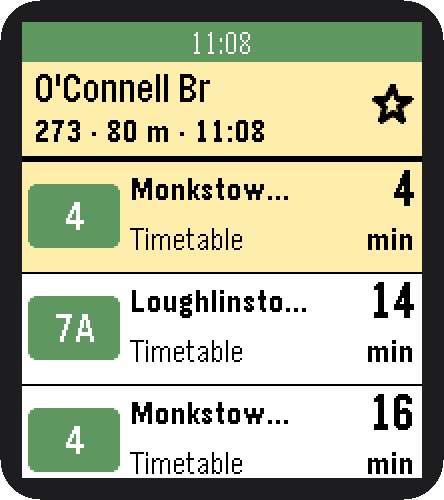

<h1 align="center">🚌 Dublin Bus for Pebble</h1>

<p align="center">
  The next buses at Dublin stops on your wrist, with live times and big, high-contrast text.<br>
  Built for the <b>Pebble Time 2</b>.
</p>

<table align="center">
  <tr>
    <td align="center"><br><b>Nearby</b><br>Closest stops, by GPS</td>
    <td align="center"><br><b>Departures</b><br>Live or timetable times</td>
  </tr>
  <tr>
    <td align="center"><br><b>Save a stop</b><br>Hold Select</td>
    <td align="center"><br><b>Favourites</b><br>Your saved stops</td>
  </tr>
</table>

## Features

- **Nearby stops**: the 10 closest stops within 1 km, with distance and routes
- **Live times**: realtime NTA data marked *Live*, with the timetable as a fallback (*Timetable*)
- **Favourites**: save your usual stops; they sit one Up press away at the top of Nearby, and load ahead of time
- **Location refresh**: flick your wrist for a new fix. The header shows how old it is (*GPS now*, *GPS 3 min*)
- **Easy to read**: large bold fonts and strong TFI yellow and green that hold up on the Time 2's display

## Controls

| Screen | Button | Action |
|---|---|---|
| Nearby | **Up / Down** | Scroll |
| | **Up** from the first stop | Favourites |
| | **Up** on Favourites | Refresh location |
| | **Flick wrist** | Refresh location |
| | **Select** | Open the stop |
| Departures | **Select** | Refresh times |
| | **Hold Select** | Save or remove the favourite |
| Any | **Back** | Previous screen |

## Setup


1. Get a free API key at <https://developer.nationaltransport.ie>.
2. In the Pebble phone app, open **Dublin Bus → Settings**, paste the key and tap **Save to watch**.
   The key stays on your phone. It is never in this repo or the app file.
3. Allow location for the Pebble app so Nearby can find you.

The settings page also lists your favourites and adds stops by number.

Until a key is set, the watch shows the message on the right.

<br clear="right">

## How it works

```
GitHub Pages: timetables, rebuilt nightly  ─┐
                                            ├──►  phone (PebbleKit JS)  ──►  watch (C)
NTA GTFS-Realtime API: live delays  ────────┘
```

- **Timetables**: `build_site.py` turns TFI's static GTFS into a small file per stop. `.github/workflows/site.yml`
  rebuilds them every night and publishes them to [GitHub Pages](https://alexandru-dorofte.github.io/pebbleDublinBus/).
  The phone downloads only the stops you open.
- **Live times**: the phone fetches the NTA feed and applies the delays to the timetable. It calls the API at most once
  every 61 s, per the [NTA usage policy](https://developer.nationaltransport.ie/usagepolicy) (one call per 60 s per key).

## Building

```sh
node test.js                       # self-check for the departure logic
pebble build
pebble install --emulator emery    # emulator
pebble install --cloudpebble       # your watch, via the phone's Dev Connect
```

---

<sub>Data: National Transport Authority, licensed CC BY 4.0, provided as is. Not affiliated with Dublin Bus or TFI.</sub>
