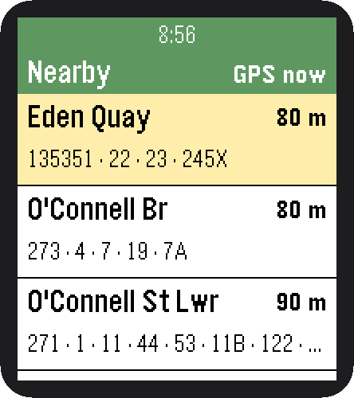
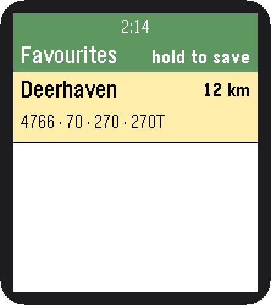
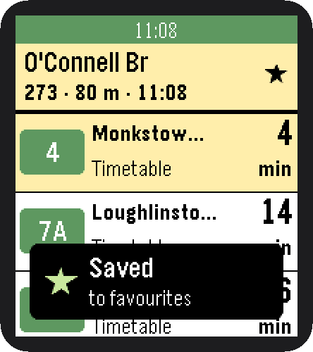
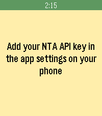

# pebbleDublinBus

Next buses at Dublin stops, on a Pebble Time 2, with large, high-contrast text.

## Features

- **Nearby**: the 10 closest stops within 1 km, from your phone's GPS. A **★ Favourites** row at the end opens your saved stops
- **Refresh location**: flick your wrist, or press Up on the top row. The header shows how old the fix is (*GPS 3 min*)
- **Departures**: Select opens a stop. Live NTA GTFS-Realtime times (*Live*), with the timetable as fallback (*Timetable*)
- **Favourites**: long-press Select on a stop to save or remove it, or manage them in the phone settings
- **Timetables**: built nightly by `.github/workflows/site.yml` (`build_site.py`) and hosted on
  [GitHub Pages](https://alexandru-dorofte.github.io/pebbleDublinBus/). The phone downloads only the stop you open

| Nearby | Favourites | Saved | Settings needed |
|:---:|:---:|:---:|:---:|
|  |  |  |  |

## Setup

1. Get a free API key at <https://developer.nationaltransport.ie>.
2. Open the app's settings in the Pebble phone app and paste the key. It is stored only on your phone.

The app calls the realtime API at most once every 61 s, per the
[NTA usage policy](https://developer.nationaltransport.ie/usagepolicy) (one call per 60 s per key).

## Building & running

```sh
node test.js                       # self-check for the departure logic
pebble build
pebble install --emulator emery
pebble install --cloudpebble       # your watch, via the phone's Dev Connect
```

Data: National Transport Authority, licensed CC BY 4.0, provided as is.
